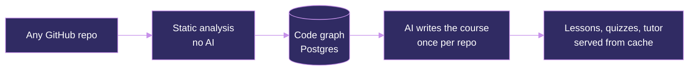

  

  

  
  
  

##  Hey, I'm Dharoon

A second-year CSE student at **VIT Vellore** who builds things before fully knowing how, and learns the rest on the way.

Lately I care most about the parts of AI products you don't see: background jobs, databases, and the security that keeps them fast, cheap and safe.

- 🔭 Building **Gitpath**: any GitHub repo in, an interactive course out
- 🔐 Security habits: rate limits, bot checks, encrypted secrets, scans in CI
- 🏆 Won **Best Fresher** at a hackathon
- 💬 Ask me about BullMQ, Prisma, Flutter, or why your API needs a rate limit

 

##  Featured work

### 🎓 Gitpath

**Give it any GitHub repository and it builds an interactive course: lessons, quizzes and an AI tutor.**

The order is the trick. The code is analysed **without AI first**, then the model writes the course **once per repo** and it's stored. Every learner after that is served from the database, so it stays fast for users and cheap to run.

- **Backend:** background jobs with BullMQ and Redis, Postgres with Prisma, Docker, CI with GitHub Actions
- **Security:** rate limiting, Cloudflare Turnstile to block bots, encryption for stored secrets, GitHub OAuth login, a security scan in the CI pipeline

🔒 Source is private. Happy to demo it.

### 🚨 Raksha Thunai

**A women's safety app our team built. I wrote most of the code.**

You trigger it with a gesture and it starts listening to the surroundings. It understands distress in Indian languages, including mixed ones like Tanglish, then alerts guardians with your live location.

`gesture` → `listen` → `spot distress` → `alert guardians` → `share live location`

- **Built:** the Flutter app and the TypeScript backend
- **Security:** it handles people's locations and emergencies, so every route is protected: authentication, OTP verification, and validation on every request

### 🧠 LearnFlow

**An AI learning platform that turns a complex topic into a structured learning journey.**

It breaks a subject into subtopics, finds high-quality educational videos ranked by relevance, popularity and engagement, and builds a personalised YouTube playlist in your preferred language. Students spend their time learning instead of searching.

`topic` → `subtopics` → `rank the best videos` → `playlist in your language`

### 💚 AI Student Wellbeing Platform

**Mental wellness support built for campuses with thousands of students.**

Students get emotional support through AI conversations, mood tracking and personalised wellbeing recommendations. Licensed therapists get structured reports so they can assess and step in faster, and institutions can spot at-risk students early and lighten the load on counselling teams.

`talk it out` → `track mood` → `personal recommendations` → `report for therapists`

##  More builds

<table>
  <tr>
    <td width="50%" valign="top">
      <h4>🦺 Safe Step</h4>
      A wearable that detects impacts and falls and alerts caretakers on WhatsApp in seconds, backed by a cloud service and a web dashboard.
        
      🔗 <a href="https://mdp2026.netlify.app/">mdp2026.netlify.app</a>
    </td>
    <td width="50%" valign="top">
      <h4>🦉 Socrates Aid</h4>
      An AI tutor that guides students with questions instead of handing them answers, with a teacher dashboard and a Python analytics module.
        
      🔗 <a href="https://github.com/DharoonBalajii/socrates-aid-app">socrates-aid-app</a>
    </td>
  </tr>
</table>

##  Toolbox

<table>
  <tr>
    <td><b>Languages</b></td>
    <td></td>
  </tr>
  <tr>
    <td><b>Backend & data</b></td>
    <td></td>
  </tr>
  <tr>
    <td><b>Apps & web</b></td>
    <td></td>
  </tr>
  <tr>
    <td><b>Cloud & shipping</b></td>
    <td></td>
  </tr>
</table>

##  Contributions

  <picture>
    <source media="(prefers-color-scheme: dark)" srcset="https://raw.githubusercontent.com/DharoonBalajii/DharoonBalajii/output/github-contribution-grid-snake-dark.svg">
    <source media="(prefers-color-scheme: light)" srcset="https://raw.githubusercontent.com/DharoonBalajii/DharoonBalajii/output/github-contribution-grid-snake.svg">
    
  </picture>

##  Let's build something

Got an idea, a hackathon, or a bug that needs breaking? See more of my work at [dharoonbalajii.space](https://www.dharoonbalajii.space), or find me on [LinkedIn](https://www.linkedin.com/in/dharoonbalajii/) or at [dharoonbalajiie@gmail.com](mailto:dharoonbalajiie@gmail.com).

  

